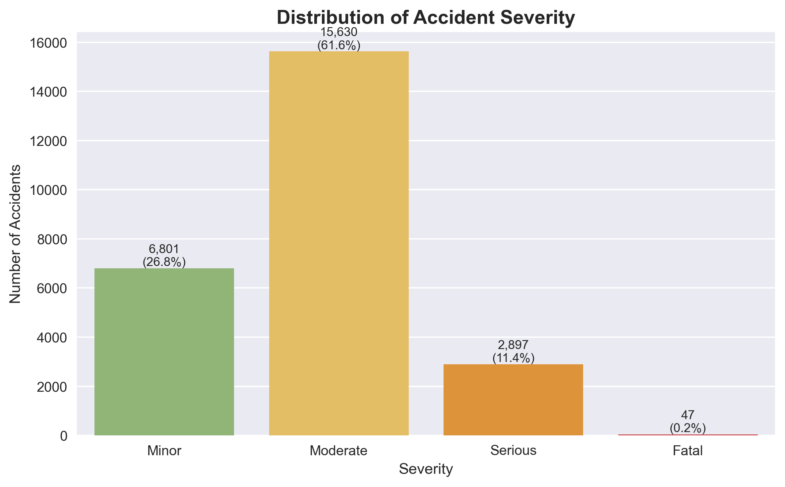
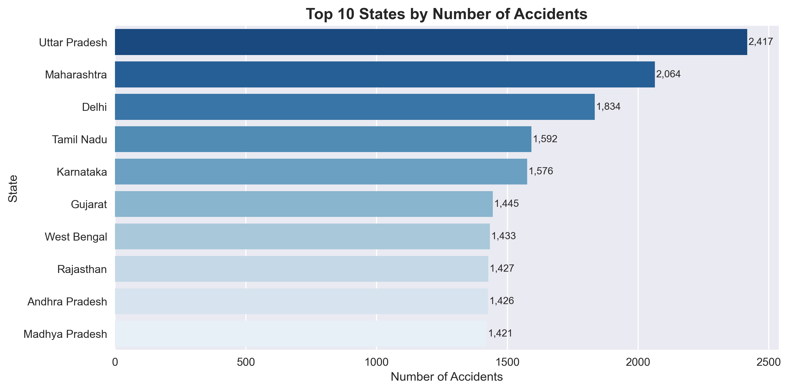
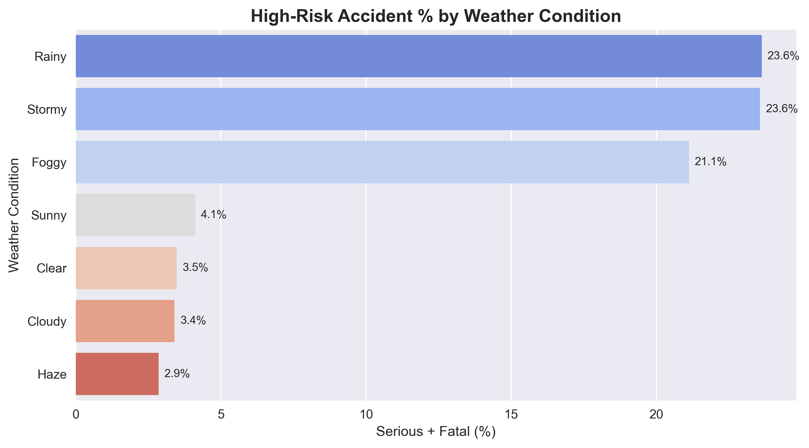
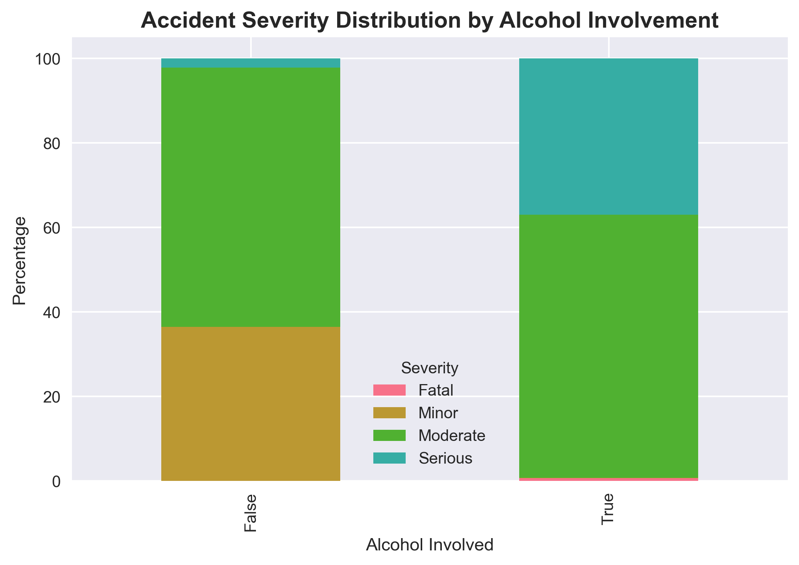
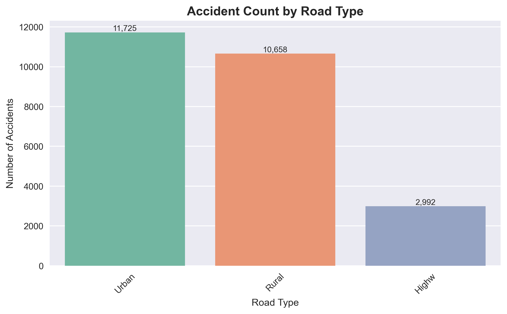
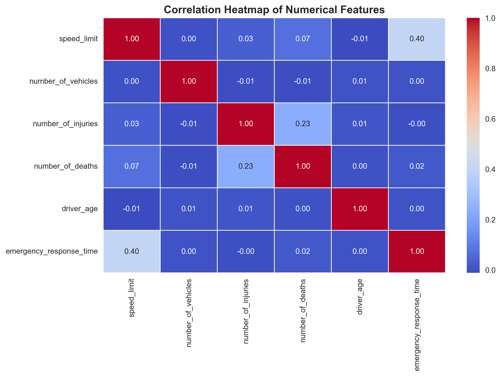

<p align="center">
</p>

<h1 align="center">🚦 Indian Road Accident Analysis using Python</h1>

Road Accident Data Analysis using Python, Pandas, NumPy, Matplotlib, and Seaborn to identify accident patterns, severity, causes, and trends.


# 📌 Project Overview

Road accidents remain one of the leading causes of fatalities worldwide. This project performs an in-depth **Exploratory Data Analysis (EDA)** on Indian road accident data to identify patterns influencing accident severity.

The analysis focuses on factors such as weather conditions, road type, alcohol involvement, vehicle characteristics, and geographical distribution to generate actionable insights for improving road safety.

---

# 🎯 Objectives

- Analyze accident severity distribution.
- Identify high-risk weather conditions.
- Study accident distribution across Indian states.
- Analyze the impact of alcohol on accident severity.
- Compare accident frequency across road types.
- Perform statistical validation using Chi-Square Tests.
- Generate actionable road safety recommendations.

---

# 📂 Dataset

This project is based on a publicly available **Indian Road Accident Dataset** from Kaggle.

To support more comprehensive exploratory analysis, the original dataset was expanded using **AI-assisted synthetic data generation** while preserving the original schema and realistic feature relationships. The expanded dataset is intended **solely for educational and portfolio purposes**.

### Dataset Summary

- **Total Records:** 25,375
- **Features:** 24
- **Format:** CSV

---

# 🛠 Technologies Used

- Python
- Pandas
- NumPy
- Matplotlib
- Seaborn
- Jupyter Notebook

---

# 🧹 Data Preprocessing

The following preprocessing steps were performed:

- Missing Value Analysis
- Duplicate Record Check
- Data Type Conversion
- Feature Engineering
- Outlier Analysis
- Structural Missing Value Handling

---

# 📊 Exploratory Data Analysis

The project includes:

- Univariate Analysis
- Bivariate Analysis
- Multivariate Analysis
- Correlation Analysis
- State-wise Analysis
- Weather Analysis
- Road Type Analysis
- Alcohol Impact Analysis
- Statistical Validation

---

# 📈 Key Visualizations

## 1️⃣ Distribution of Accident Severity



**Insight**

- Moderate accidents account for the majority of recorded cases.
- Serious and Fatal accidents together represent a much smaller but critical proportion, indicating the importance of preventive safety measures.

---

## 2️⃣ Top 10 States by Number of Accidents



**Insight**

- Uttar Pradesh recorded the highest number of accidents.
- Maharashtra and Delhi also contribute significantly to the total accident count.

---

## 3️⃣ High-Risk Accident Percentage by Weather Condition



**Insight**

- Rainy and Stormy weather show the highest proportion of Serious and Fatal accidents.
- Poor weather conditions significantly increase accident severity.

---

## 4️⃣ Accident Severity by Alcohol Involvement



**Insight**

- Alcohol involvement substantially increases the proportion of Serious accidents.
- The findings emphasize the importance of strict enforcement against drunk driving.

---

## 5️⃣ Accident Count by Road Type



**Insight**

- Urban and Rural roads account for the highest number of accidents.
- Highways have fewer accidents but often involve greater severity due to higher vehicle speeds.

---

## 6️⃣ Correlation Heatmap



**Insight**

- Most numerical variables show weak linear correlations.
- A moderate positive relationship exists between **Speed Limit** and **Emergency Response Time**, while **Number of Injuries** has a noticeable positive correlation with **Number of Deaths**.

---

# 📊 Statistical Analysis

Chi-Square Tests were conducted to validate relationships between important categorical variables.

### Tests Performed

- Weather vs Severity
- Alcohol Involvement vs Severity
- Road Type vs Severity
- Accident Cause vs Severity

The statistical analysis confirmed significant relationships among several accident-related factors, strengthening the insights obtained during exploratory analysis.

---

# 💡 Major Findings

- Moderate accidents constitute the largest share of reported incidents.
- Rainy and Stormy weather conditions significantly increase accident severity.
- Alcohol involvement is associated with a higher proportion of Serious accidents.
- Uttar Pradesh reported the highest accident count among all states.
- Urban roads recorded the highest accident frequency.
- Highways, despite fewer accidents, are associated with higher severity.

---

# 🚀 Future Scope

- Develop a Power BI Dashboard
- Predict Accident Severity using Machine Learning
- Build an Interactive Streamlit Web Application
- Perform GIS-based Accident Hotspot Analysis

---

# 📁 Project Structure

```
Road-Accident-Analysis
│
├── data
│   └── road_accident_dataset_expanded.csv
│
├── notebook
│   └── Road_Accident_EDA.ipynb
│
├── images
│   ├── severity_distribution.png
│   ├── state_analysis.png
│   ├── weather_analysis.png
│   ├── alcohol_analysis.png
│   ├── road_type_analysis.png
│   └── correlation_heatmap.png
│
│
├── README.md
